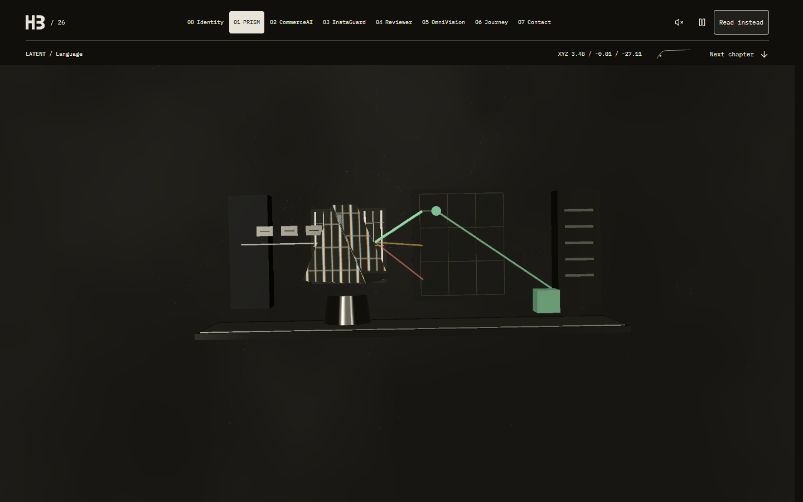
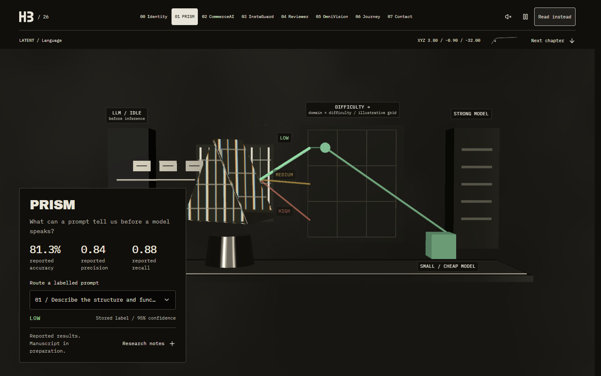
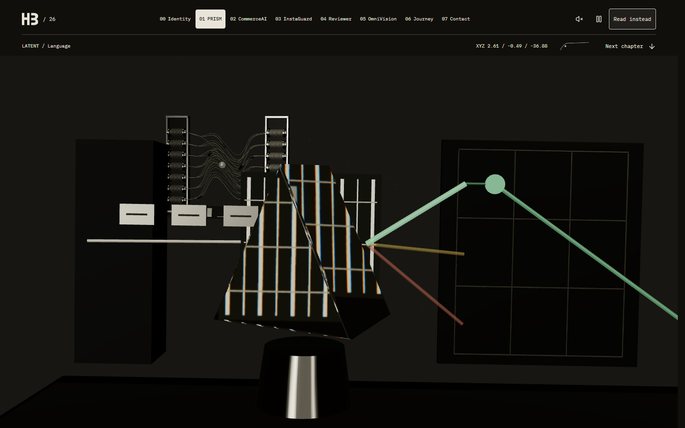

# Run 1: why LATENT does not feel like flight

Verified on 21 October 2026 against the local repository, beginning at `54ef6f1`, on `glass-revamp`. Scope: diagnosis and flight bugs only. The supplied brief is recorded in [REVAMP.md](REVAMP.md). Palette, materials, model redesign and the new camera direction remain assigned to later runs.

## Finding

**3D rendering and z travel already work. The flat impression comes primarily from scene composition and camera framing, compounded by actual navigation/lifecycle bugs.** This is not a missing WebGL context, undersized Canvas, orthographic camera or universally forced reduced-motion mode.

The browser showed the same PRISM apparatus growing substantially as the camera moved from z = −27.11 through −32.00 to −36.88. Its prism, pedestal and grid change their relative projections; CommerceAI becomes visible behind it. These are genuine perspective frames, not three different illustrations.

## Root causes

| Finding | Evidence in the starting implementation | Disposition |
| --- | --- | --- |
| Front-facing rest poses | `CameraRail` samples a room origin, places the camera exactly 12 units in front with only 0.3 units of vertical offset, then looks at that origin. Every chapter settles into virtually the same near-head-on orientation. FOV is 40°. | New look-ahead camera/45–55° framing belongs to Run 3. The existing curve and FOV are retained here. |
| Shallow stage composition | PRISM spans approximately 10 units horizontally, but most tokens, beams, grid and destinations occupy a shallow z band. Its base reinforces a tabletop silhouette. Hero type is 0.27 units deep. Other instruments also use mostly coplanar arrangements. | Multi-depth placement and new sculpted models belong to Runs 3/4. |
| Automatic fitting makes instruments read as miniatures | `Room` fits a width/height envelope at the fixed resting distance. Desktop limits ordinary scenes to 74% width/70% height; mobile uses 90% width/45% height. The tall PRISM caption then dominates the phone. | Composition/layout work belongs to Runs 2/3. The six captures retain this issue honestly. |
| Scene culling follows the destination before the camera arrives | Mounting follows rounded target chapter; visibility follows target progress within ±0.8. During the baseline jump to chapter 5, the camera was still at z = −26.56, but only rooms 4/5/6 were mounted, with only 5 visible. Nearby PRISM at z = −44 was already gone. Contact immediately removed every other room as soon as it became the target. | **Fixed.** Mount and visibility decisions now follow rendered rail progress, with the destination neighborhood available ahead of arrival. Contact sheds other rooms after arrival. |
| Aim snaps while position eases | Position interpolated towards the target independently of the unsmoothed look-at point. A distant jump could point at the far destination while the camera was still between earlier rooms; position also took an interpolated chord instead of sampling the rail throughout travel. | **Fixed.** One eased scalar samples the existing rail for both camera position and aim. Roll follows that same scalar. This repairs synchronization without implementing Run 3's new rail. |
| Loader shader warmup outlives scene materials | `Training` called `compileAsync(frame.scene, frame.camera)` for the entire live world. Rapid navigation/reader transitions could dispose a material while Three r182's readiness timer still accessed `currentProgram.isReady()`. A clean regression reproduced `Cannot read properties of undefined (reading 'isReady')`. | **Fixed.** Precompile only the persistent HB mesh with `compile(mesh, camera, targetScene)`, preserving live environment/lighting without an asynchronous readiness timer referencing disposable rooms. No renderer error is suppressed. |
| Diagnostics misidentify static states | The Canvas `data-frame-mode` reported continuous unless Contact was settled, even when pause/reduced motion actually selected demand rendering. Cached `__latentPerf.fps` could remain nonzero after rendering stopped. | **Fixed mode label.** It now reports R3F's actual `always`/`demand`/`never` mode. Verification counts actual R3F callbacks over wall time instead of treating cached telemetry or browser RAF as rendered FPS. |

Captions and projected labels now also wait for the camera's settling state, preventing destination annotations from appearing over a different room during a fast jump. Pause suppresses additional camera easing and roll while still permitting explicit scroll navigation. Accessibility and content remain intact.

## Browser checks

Started a dedicated Vite dev server at **http://127.0.0.1:5174** because 5173 was already occupied; the existing service was left alone. Playwright drove installed Chrome with a 1× device scale. Normal-motion profiles explicitly used `prefers-reduced-motion: no-preference`; a separate emulation exercised `reduce`.

| Check | Observed final result |
| --- | --- |
| Console and context | Zero page errors and zero console errors. WebGL context remains alive at all six capture positions. One existing ANGLE shader diagnostic remains, including precision/division warnings; this is not a completely silent console. |
| Canvas dimensions | Viewports 1440×900 and 390×844; Canvas CSS sizes 1425×900 and 375×844. The 15px difference is the intentionally reserved document scrollbar gutter, not a small scene window. No horizontal overflow. |
| Persistent Canvas | Exactly one Canvas, with the same DOM identity throughout scroll navigation. Reader intentionally removes it; returning creates one new Canvas. |
| Camera depth | Desktop z = −27.11368 / −32.00342 / −36.87871 at chapter progress 0.75 / 1 / 1.25. Mobile z is effectively identical. Native wheel input also moved z from −32.00 to −39.25. |
| Distant navigation | At target progress 5.00033, rendered progress 0.58314 retained visible chapters 0/1; progress 1.50893 retained 1/2; later samples retained 4/5 before settling at 5. Camera yaw stays approximately zero instead of pointing abruptly at the destination. |
| Pause | Actual frameloop is `demand`; **0 rendered FPS** at idle. Explicit navigation still updates the view. |
| Reduced motion | Actual frameloop is `demand`; direct camera pose, no roll; **0 rendered FPS** at idle. |
| Reader | Canvas count becomes 0; all chapter headings remain HTML. Enter 3D restores exactly one Canvas at Identity. |
| Contact | Settled portrait uses demand rendering and **0 rendered FPS**. Re-train wakes continuous rendering, measured at 165 FPS; leaving Contact returns to `always`. |
| Visibility handler | Simulated `document.hidden` plus `visibilitychange` selects `never` and 0 rendered FPS, then restores `always`. This tests the handler, not physical background-tab behavior. |
| Build | `npm run build` passes TypeScript and Vite (2515 modules). Vite reports plugin timing information. |

## Measured frame rate

Actual R3F callbacks counted over approximately 2.2 seconds per screenshot position, independently of browser RAF. Renderer: **ANGLE / NVIDIA GeForce RTX 3070 / Direct3D11**. Mobile is a viewport emulation on this same desktop GPU, not a phone measurement. CPU throttling is not applied in Run 1; 1×/4× CPU comparisons belong to Run 5.

| Viewport | Progress 0.75 | Progress 1.00 | Progress 1.25 |
| --- | --- | --- | --- |
| 1440×900 | 165.3 FPS, DPR 1.5 | **63.6 FPS**, DPR 1 | 165.3 FPS, DPR 1 |
| 390×844 | 165.3 FPS, DPR 1.25 | 165.2 FPS, DPR 1 | 165.2 FPS, DPR 1 |

The lower desktop PRISM sample is retained rather than replaced with a later warmed-up measurement. Adaptive DPR and first-use material/shader costs remain relevant; this run does not claim to eliminate startup stalls or certify smooth flight on integrated graphics. During rapid cold jumps, lazy scene loading and compilation can still produce hitches. Quality-tier/material budgeting and the new transition staging remain future work.

## Reviewed screenshots

All six final PNGs were opened and visually inspected. The desktop sequence visibly approaches and passes the existing apparatus; the mobile sequence exposes both the small resting instrument and its off-centre perspective on departure. The warm palette, shallow models and caption dominance remain visible because this run does not redesign them. Captions are intentionally hidden at the two fractional transit positions.

| Viewport | Approach, p = 0.75 | At PRISM, p = 1 | Passing, p = 1.25 |
| --- | --- | --- | --- |
| 1440×900 | [Approach](docs/glass-run1/1440-0-75.png) | [PRISM](docs/glass-run1/1440-1.png) | [Pass](docs/glass-run1/1440-1-25.png) |
| 390×844 | [Approach](docs/glass-run1/390-0-75.png) | [PRISM](docs/glass-run1/390-1.png) | [Pass](docs/glass-run1/390-1-25.png) |





## Reproduction and scope

[Final raw report](docs/glass-run1/report.json), [baseline raw report](docs/glass-run1/before-report.json), and [Playwright regression](scripts/check-flight.cjs) are committed with this diagnosis. The regression requires Playwright and an installed Chrome; it tests the Vite development build because it observes R3F's development-module store. It never imports a second Zustand state instance. A preliminary harness did that after hot reload and produced stale readings; those preliminary results are excluded. A separate preliminary clean run exposed the shader disposal race, which was fixed before the final passing run.

Start Vite, then run:

```powershell
node node_modules/vite/bin/vite.js --host 127.0.0.1 --port 5174 --strictPort
# In a second terminal with Playwright available:
node scripts/check-flight.cjs
```

`PLAYWRIGHT_MODULE` can point to an existing Playwright package outside the checkout. `FLIGHT_URL` overrides the default dev URL. New reports/captures go into ignored `.qa/glass-run1/verified/`.

Impeccable context, audit guidance and craft floor were read; the installed Taste Skill's existing-site/scenes guidance informed the screenshot review. Its source lint reported 0 FAIL/0 WARN for the selected camera/state/label files. Its standalone browser inspector failed at CDP `Page.enable`; Playwright supplied the actual rendered checks. No all-site taste score, complete accessibility audit, cross-browser certification or physical-device performance claim is made. The owner-pinned no-redesign scope takes precedence over the skills' broader style recommendations. No Magic MCP was exposed for this run; 2D controls are unchanged.

Run 1 repairs continuity/lifecycle bugs and proves real perspective travel. It does **not** resolve the art-direction problems: Run 2 still owns ink/ice/signal tokens, materials, lighting and captions; Run 3 owns the new depth rail, look-ahead, fog and transitions; Runs 4/5 own the sculpted models, portrait/content and final polish.
